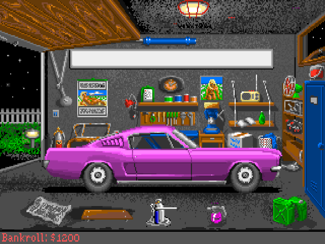
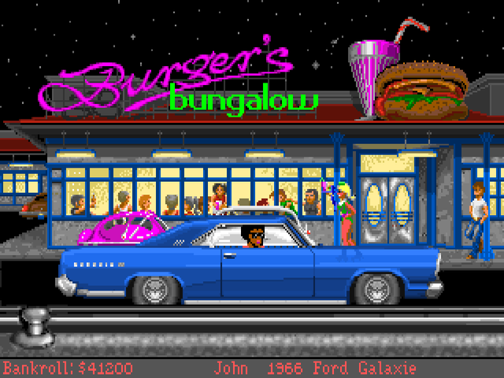
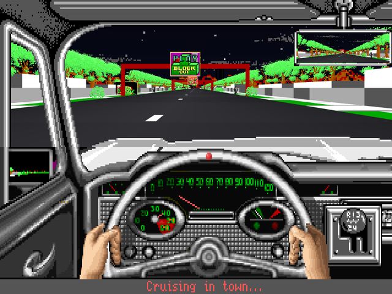
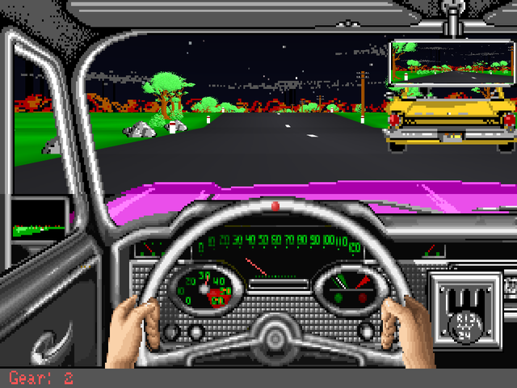
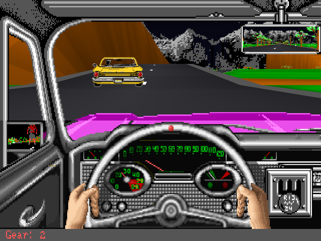
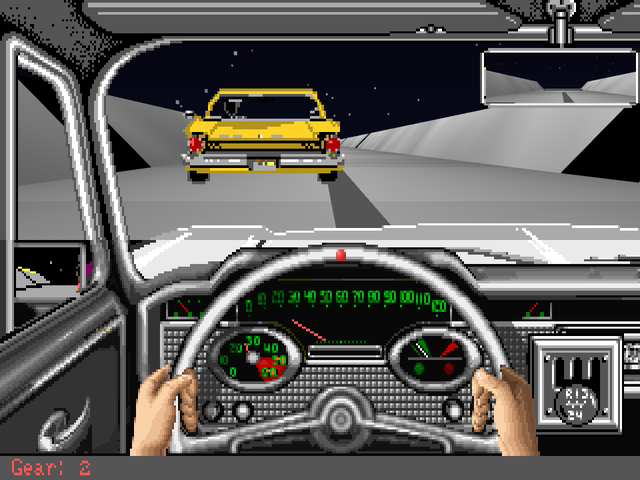

# Street Rod 2: The Next Generation — SDL3 port

A faithful native port (C, SDL3) of California Dreams' *Street Rod 2: The Next Generation* (1991),
in the making. Not an emulator. It builds on the engine of the
[Street Rod port](https://github.com/kylofon/street-rod-sdl3), since both games share most of their
code. The original game files are not included: the port reads them from a `Game` folder at run
time.

Status and plan: [PLAN.md](PLAN.md) (as a page: `python tools/plan_site.py`, then open
`site/index.html`). Agent rules: [CLAUDE.md](CLAUDE.md).

## Credits

- Source code of this port: [kylofon/street-rod-2-sdl3](https://github.com/kylofon/street-rod-2-sdl3).
- The engine it builds on: [kylofon/street-rod-sdl3](https://github.com/kylofon/street-rod-sdl3).
- [Street Rod Online](https://www.streetrodonline.com/): the official home of the games, where MK Consultancy
  offers the original PC and Amiga releases for download.
- *Street Rod* and *Street Rod 2* were made by California Dreams / Logical Design Works (1989, 1991).
- Copyright holder and licence holder of the games: **MK Consultancy** (Marco Kleijer). In Marco's words:

  > My name is Marco Kleijer, I'm a Freelance Java Specialist, I create software for a living. In December
  > 2012 my company, MK Consultancy, acquired copyright ownership of Street Rod and Street Rod 2. They are
  > the license holders of this software.

## Screenshots

With the Amiga graphics and the 3D race view (both the default):

| | |
|---|---|
|  |  |
| The garage | Burger's Bungalow |
|  |  |
| Cruising in town | Drag race |
|  |  |
| Mulholland drive | Aqueduct race |

## Running

Download: [the latest release for Windows x64](../../releases/latest) (unzip, start `Street Rod 2.exe`).

**First start:** when the game folder (`Game\`) does not hold the game's files, a setup window downloads the PC
release and the Amiga disks from [Street Rod Online](https://www.streetrodonline.com/), unpacks them there with a
progress bar, makes the Amiga picture set (`gfx\`) and starts the game. When the files are there it goes straight
into the game. Nothing else to install (no Python).

Build (MSYS2 mingw64, see `sr2port/PORTING.md`), then either start
the launcher, **`Street Rod 2.exe`** (built beside `sr2port.exe` when wxWidgets 3.2 is installed: game folder,
graphics, sound AdLib / Normal, the game's switches, window size, full screen), or run the port directly:

```text
sr2port.exe --game-dir Game speaker      (PC speaker instead of AdLib)
sr2port.exe --game-dir Game              (VGA and AdLib; the original's video and sound menus are not shown)
```

## Enhancements (work in progress)

The game logic stays the original's. Enhancements sit on top, each behind a switch, with the original as the
fallback (`--classic`):

- **3D race view** (default): the races and town drives in 3D with smooth motion, the town's houses and
  overhead signs, 4x anti-aliasing. `--classic` brings back the original 2D view; `--rain`, `--dusk` and
  `--night` add weather and time of day.
- **Smooth 2D animation**: the game's screen refresh follows the display (no judder on 60 / 120 Hz screens).
- **Amiga graphics** (the default; `--pc` for the PC pictures, WIP): the Amiga release's art in full colour: title, garage, gas station,
  Burger's Bungalow, newspaper, engine screens, portraits, the cars (Amiga bodies, customisation pieces
  and turning wheels, repainted in the car's colour) and the race dashboards (the driver's hands turning
  the wheel). The paint job adds a swatch of 20 colours; the colours chosen are kept beside the saved game
  (`HOTROD<n>.SAV.paint`), the save itself stays the original's. The game draws its 16-colour screen as
  always; a full-colour copy of the video memory is kept in step with every drawing step and shown instead.
  Pictures without an Amiga version stay the PC ones (car underside, tyre-change tyres).
  The art comes from the Amiga disks in `Game\` (`SR2AMIGA_DISK1.adf`, `SR2AMIGA_DISK2.adf`, fetched by the
  first-start setup): when there is no `gfx\` folder the game makes it once, next to the executable (every
  picture by id, Amiga where there is one, else PC; cars, wheels); nothing is converted while playing.
  `python tools/amiga_export.py` makes the same folder. `gfx\` is game art and is not in git.
- **Music** (AdLib): the playlist's songs follow each other without the original's ~2 minute silence, and
  the garage juke box opens a menu: "Squelch it !" / "Catch some tunes" or pick one of the six songs
  (including `MSR20.MUS`, which the game never plays). `--classic` keeps the original's on / off toggle.
- Copy protection question skipped (`--protection` shows it).

Known WIP: small PC pieces the game pastes onto Amiga backgrounds (garage lamp, floor papers), text boxes
keeping the game's white behind their text, and the race graphics still being the PC ones.

## Layout

```text
Game\        the installed DOS game, and your Amiga disks for --amiga (not in git)
gfx\         the picture set for --amiga, made by tools\amiga_export.py (not in git)
_tools\      junction to Ghidra + JDK (shared with the other ports, not in git)
tools\       reverse-engineering scripts (Python, Ghidra)
port\        RE guide, function indexes, SR1 matches, symbols, specs (port\spec), formats (port\formats)
docs\        manual PDFs/text (not in git)
work\        generated output and DOSBox reference captures (not in git)
site\        local HTML view of PLAN.md with token usage (not in git)
sr2port\     the port (from phase 4)
```

## License

MIT for the code in this repository (see [LICENSE](LICENSE)). *Street Rod* and *Street Rod 2* are © MK
Consultancy (originally California Dreams / Logical Design Works); the game files are not included.
